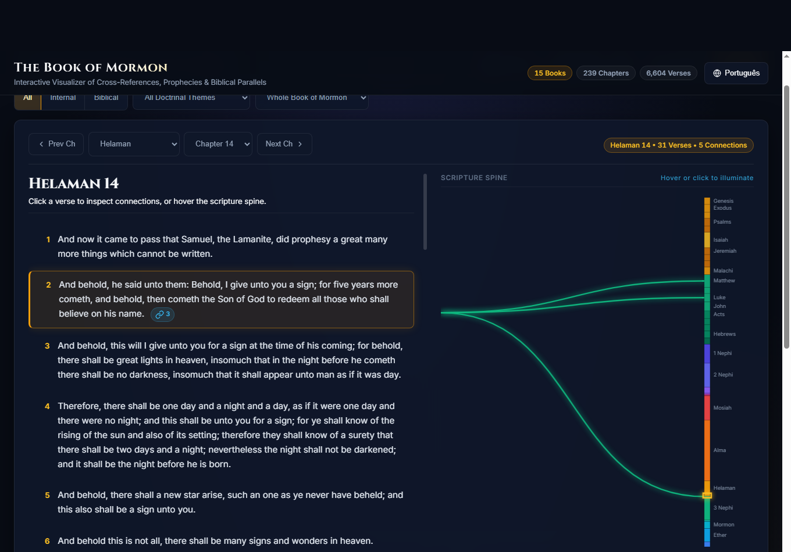

# Book of Mormon Cross-References | Interactive Visualizer

An interactive, high-performance web visualization exploring biblical cross-references, prophecy fulfillments, quotations, and doctrinal parallels across all **15 books**, **239 chapters**, and **6,604 verses** of the Book of Mormon.

Inspired by Chris Harrison & Christoph Römhild's classic 2007 arc diagram and [trekhleb/bible-cross-references](https://github.com/trekhleb/bible-cross-references), redesigned from the ground up for modern web standards using Vanilla JavaScript, HTML5 Canvas 2D, and Swiss Modernist / Scholarly typography.

[](LICENSE)

---

## 📸 Screenshots

### 1. Dual Bridge View (Bible ↔ Book of Mormon)
*A bi-testamental bridge linking Old & New Testament scriptures (top rail) to the Book of Mormon (bottom rail) via glowing Bézier beams.*


---

### 2. Sacred Ring View (Mandala Chord Ring)
*Circumferential chord diagram inspired by sacred geometric rings, with internal cross-references criss-crossing a radiant core.*


---

### 3. Interactive Book Zoom & Chapter Timeline
*Selecting any specific book expands the diagram to 100% width, transforming the axis into an interactive chapter-by-chapter timeline.*


---

### 4. Threads View (Chapter Reading & Living Scripture Threads)
*Verse-by-verse chapter reading mode inspired by `trekhleb/bible-cross-references`, projecting living cubic Bézier threads from each verse in real-time to a unified canonical scripture spine.*



---

## ✨ Key Features

- **Multi-Mode Visualizations:**
  - **Bridge (Bible ↔ BOM):** Dual-rail architecture revealing the harmonizing threads between biblical texts (Isaiah, Matthew, Luke, John, Psalms, Revelation) and Book of Mormon revelations.
  - **Sacred Ring:** 360-degree radial mandala with curved chord beams and real-time scripture stats in the center orb.
  - **Threads (Reading Mode):** Verse-by-verse chapter reader with smooth cubic Bézier threads connecting directly to a vertical Scripture Spine (Bible Old & New Testament + Book of Mormon), with real-time scrolling tracking and hover illumination.
- **Deep Book Zoom Mode:**
  - Select any book (e.g. *2 Nephi*, *Alma*, *3 Nephi*) to zoom in with generous verse spacing.
  - Interactive chapter timeline showing proportional verse distribution.
  - Click any chapter (`Ch 1`, `Ch 2`, etc.) to jump straight to its opening verse.
  - 1-click `↺ Reset Zoom` button to return to the full 15-book canon.
- **Magnetic Snapping & Hotspots:**
  - Cursor magnetically snaps within 20px to the nearest connected verse, preventing missed clicks.
  - Glowing hotspot dots mark verses that carry significant theological connections.
- **Sequential Connection Tour:**
  - Step through hundreds of cross-references sequentially using `◀ Previous`, `Next ▶`, or `🎲 Random`.
  - Book-aware counter adapts when zoomed (e.g. `12 / 431 in 2 Nephi`).
- **Bilingual Edition & Complete Portuguese Corpus (i18n):**
  - Instant 1-click toggle between **English** and **Português** with automatic browser language detection (`pt-BR`) and saved preference.
  - Complete dual-language corpus with all 6,604 verses in English (`data/verses_en.json`) and Portuguese (`data/verses_pt.json`).
  - 100% of all 234 cross-reference notes, Bible book names (`Lucas`, `Isaías`, `Salmos`), and classification tags fully localized.
- **Official Scripture Study Links:**
  - Tapping any verse text box, connection card, or official link button opens the exact chapter and verse on [ChurchofJesusChrist.org](https://www.churchofjesuschrist.org/study/scriptures/bofm) in the active language (`lang=por` or `lang=eng`).
- **Ancient Semitic Literary Structures:**
  - Interactive Chiastic Tree explorer (e.g. Alma 36 inverted parallelism revolving symmetrically around verse 18: crying unto Jesus Christ for mercy).
  - Mormon's editorial formulas (*"And thus we see"*), the Land Covenant, and authentic Semitic Hebraisms (construct states, solemn oaths).
- **High-Resolution Study Card Export (PNG):**
  - 1-click `Save Card (PNG)` client-side exporter rendering beautiful 1200x630px study cards with scripture text, parallels, and mini-arc diagrams for social sharing (Instagram, WhatsApp, presentations).
- **100% Static & Free to Host:**
  - Zero server requirements, 0 API dependencies, instant load times, 100% client-side static application.

---

## 🛠️ Tech Stack & Architecture

- **Frontend:** Vanilla JavaScript (ES Modules), HTML5 Canvas 2D, Modern CSS3 with CSS custom properties.
- **Design Intelligence:** Scholarly Editorial & Swiss Modernism 2.0 system (WCAG AA 4.5:1 contrast, Cinzel & Cormorant Garamond typography, 44px touch targets).
- **Tooling:** [Vite](https://vitejs.dev/) for sub-second development HMR and optimized production bundling (< 30 kB compressed).
- **Data Engineering:**
  - `data/verses_en.json`: All 6,604 verses in English (canonical text & chapter pagination).
  - `data/verses_pt.json`: All 6,604 verses in Portuguese matching official Church scripture text.
  - `data/books.json`: Metadata for all 15 books with chapter pagination and color palettes.
  - `data/cross_references.json`: Curated internal fulfillments, prophecies, typologies, and citations with bilingual notes (`note` & `notePt`).
  - `data/external_references.json`: 846 canonical biblical parallels connecting to Old and New Testament passages with bilingual notes.
  - `data/literary_structures.json`: Ancient Semitic chiastic structures, editorial formulas, and Hebraisms.

---

## 🚀 Getting Started Locally

```bash
# 1. Clone the repository
git clone https://github.com/msantana-01/book-of-mormon-cross-references.git
cd book-of-mormon-cross-references

# 2. Install dependencies
npm install

# 3. Run automated data integrity tests
npm test

# 4. Start local development server
npm run dev

# 5. Build production static bundle
npm run build
```

Open [http://localhost:5173/](http://localhost:5173/) in your browser.

---

## 🌐 Production Build & Deployment

Since this project is 100% static (HTML, CSS, Vanilla JS, and optimized JSON datasets), the output from `npm run build` generates a self-contained `dist/` directory that can be served from any static web server, CDN, or object storage bucket (such as GitHub Pages, Cloudflare Pages, Netlify, Nginx, or Apache).

```bash
npm run build
# The compiled files in dist/ are ready for static hosting.
```

---

## 📜 Data Sources & Legal Attribution

- **Scripture Text:** English public domain records provided by the [LDS Documentation Project / scriptures.nephi.org](https://scriptures.nephi.org/) (maintained by `@beandog`); Portuguese text sourced from official public scripture resources ([ChurchofJesusChrist.org](https://www.churchofjesuschrist.org/study/scriptures/bofm?lang=por)).
- **Cross-Reference Corpus:** Curated open datasets from `wordtreefoundation/bomdb` and open scripture scholarship.
- **License:** [MIT License](LICENSE) © 2026.
